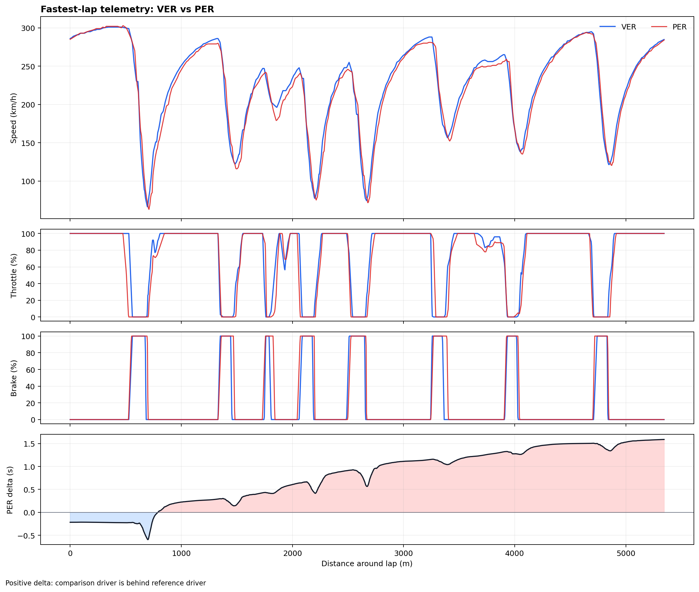

# F1 Telemetry Performance Analysis

A Python data pipeline that pulls **real Formula 1 car telemetry** from the public
[OpenF1 API](https://openf1.org), aligns two drivers' fastest laps on a common
distance grid, and shows **where on the circuit time is gained or lost**.

The default study compares Max Verstappen (VER) and Sergio Pérez (PER) in the
**2024 Bahrain Grand Prix**. They were team-mates in the same car, so the
comparison is less affected by differences in car performance.



## Key results

| Driver | Lap time (s) | Max speed (km/h) | Mean speed (km/h) | Full throttle (% of lap) | Braking (% of lap) |
|--------|-------------:|-----------------:|------------------:|-------------------------:|-------------------:|
| VER    | 92.651       | 301.0            | 228.8             | 62.3                     | 16.5               |
| PER    | 94.240       | 302.8            | 225.6             | 58.5                     | 19.9               |

- Across the aligned laps, VER finishes **1.589 s** ahead of PER on their fastest laps (both on Soft tyres).
- The gap **builds steadily through the corners rather than on the straights**. Top speeds
  are almost the same, but VER's mean speed is 3.2 km/h higher.
- VER spends **3.8 percentage points more of the lap at full throttle** and **3.4 fewer
  under braking**. On most corner exits he is back on the throttle earlier, which
  is associated with higher speed onto the following straight.
- The clearest single gains are at the Turn 1 exit (~700–900 m) and in the medium-speed
  section around 1,800–2,000 m, where VER's minimum speed is about 15–20 km/h higher.

These are observed associations, not proven causes. See [Limitations](#limitations).

## How it works

```text
OpenF1 API ──► fastest valid lap per driver ──► car telemetry (speed, throttle, brake)
          ──► integrate speed → distance       ──► smooth speed → acceleration
          ──► interpolate both laps onto one distance grid
          ──► point-by-point comparison + cumulative time delta + summary metrics
```

1. **Data acquisition.** The pipeline finds the session and each driver's fastest valid lap
   (pit-out laps are excluded), then downloads the car telemetry for that lap
   window. Responses are cached locally so later runs work offline and quickly.
2. **Distance estimation.** OpenF1 car data has no distance channel, so distance is
   computed by trapezoidal integration of speed over time.
3. **Derived channels.** Speed is reported as whole km/h, so it is smoothed with a
   centred rolling mean before it is differentiated into longitudinal
   acceleration. Without smoothing, the 1 km/h steps would show up as unrealistic spikes.
4. **Alignment.** The two laps are sampled at different moments. Both are linearly
   interpolated onto a shared 1,500-point distance grid, so each comparison is made at
   the **same place on track**, not at the same sample number.
5. **Delta and metrics.** Time delta = `comparison elapsed time − reference elapsed time`
   at each distance. A rising curve means the comparison driver is losing time there.

## Tech stack

Python 3.10+ · pandas · NumPy · Matplotlib · Requests · pytest · Jupyter

## Getting started

```bash
python -m venv .venv
source .venv/bin/activate          # Windows: .venv\Scripts\activate
python -m pip install -r requirements.txt

python scripts/run_analysis.py     # default: 2024 Bahrain GP, VER vs PER
python -m pytest                   # run the test suite
```

The first run downloads data from OpenF1 and can take a few minutes. Later runs use the
local `cache/` folder.

Compare any race, session or pair of drivers:

```bash
python scripts/run_analysis.py --year 2024 --event Monza --session R --drivers NOR VER
python scripts/run_analysis.py --year 2024 --event Silverstone --session Q --drivers HAM RUS
```

Each run writes the following to `outputs/`:

| File | Contents |
|------|----------|
| `telemetry_comparison.png` | Four-panel chart: speed, throttle, brake, cumulative delta |
| `metrics.csv` | Lap time, max/mean speed, throttle and braking share, peak acceleration and deceleration |
| `analysis_summary.md` | Auto-generated summary of the findings |

## Project structure

```text
f1-telemetry-analysis/
├── src/f1_telemetry/
│   ├── __init__.py
│   └── analysis.py          # data loading, cleaning, alignment, metrics, plotting
├── scripts/
│   └── run_analysis.py      # command-line entry point
├── tests/
│   └── test_analysis.py     # unit tests for the core calculations
├── notebooks/
│   └── 01_telemetry_walkthrough.ipynb
├── outputs/                 # results from the default study
├── pyproject.toml
└── requirements.txt
```

## Testing

Unit tests cover the core numerical logic with synthetic laps where the right answer
is known:

- derived channels (elapsed time, acceleration) are calculated correctly
- a known 0.5 s time offset between two laps is recovered exactly by the delta
- metrics rank the faster driver correctly
- input with missing channels is rejected with a clear error

## Limitations

- **Correlation is not causation.** The chart shows *where* time is lost, not *why*.
  Tyre wear, fuel load, traffic, ERS deployment and setup choices can all affect a lap.
- **Sampled public data.** OpenF1 car data is recorded at about 3–4 Hz. Short events, such as
  brief brake applications, can be missed or smeared by interpolation.
- **Estimated distance.** Distance comes from integrating speed, so small errors build
  up over the lap. The first few hundred metres also include a small offset from how
  lap-start timestamps line up. The *change* in delta is more informative than its exact
  value at the start.
- **Single-lap comparison.** One fastest lap per driver is not a statistically robust
  sample of overall pace.

## Possible extensions

- Automatic corner detection and a per-corner breakdown of time lost
- Averages over several laps, filtered by tyre compound and tyre age
- Track-map visualisation coloured by which driver is faster
- An interactive dashboard (e.g. Streamlit or Plotly)

## Data and attribution

Data comes from the public [OpenF1 API](https://openf1.org). This is an independent
project and is not affiliated with Formula 1, the FIA or any team.
